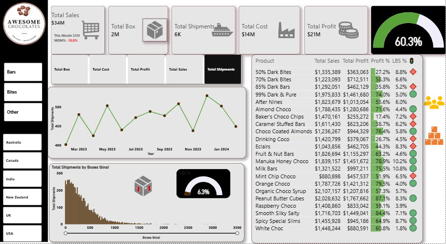

# Awesome Chocolates: Sales and Shipment Performance Dashboard (Power BI)

An interactive Power BI dashboard that tracks sales, profit, cost and shipments for a chocolate manufacturer across six countries, 22 products and 25 sales people.

## Project overview

The dashboard answers one main question: **how are sales, profit and shipments performing, and which products, people and markets drive that performance?**

It lets a manager:

- see headline numbers at a glance (sales, boxes, shipments, cost, profit, profit %)
- track the month-on-month (MoM) change in sales
- compare products and sales people on sales, profit and profit %
- spot products that miss the profit target
- filter everything by product category and by country

## Tools used

- Power BI Desktop (data model, DAX measures, visuals, buttons and slicers)
- DAX for all calculations

## Dataset

The data is a practice dataset (Awesome Chocolates) given to me by my tutor during my data analysis training. It arrived already cleaned, so no cleaning was done by me.

| Table | Rows | What it holds |
| --- | --- | --- |
| shipments | 6,113 | One row per shipment: Sales Person, Geography, Product, Date, Sales, Boxes, Cost, Boxes (bins) |
| products | 22 | Product, Category (Bars, Bites, Other), Cost per box |
| people | 25 | Sales person, Team (Yummies, Delish, Jucies, Tempo), Picture link |
| calendar | 394 | Date, Year, Month, Month name, Day of week, Name of day, Start of month. **Built by me** from the dates in the shipments table |
| Measure table | n/a | Holds all the measures so they are easy to find. **Created by me** |
| Measure selector | n/a | A small helper table that lets the viewer switch the line chart between five measures. **Created by me** |

Shipments cover about one year, from February 2023 to January 2024. Countries: Australia, Canada, India, New Zealand, UK, USA.

## Data model

A star schema: the `shipments` table sits in the middle, and `products`, `people` and `calendar` each connect to it with a one-to-many relationship.

## Measures I created

| Measure | What it calculates |
| --- | --- |
| Total Sales | Sum of sales |
| Total Box | Sum of boxes shipped |
| Total Shipments | Number of shipments |
| Total Cost | Sum of cost |
| Total Profit | Total Sales minus Total Cost |
| Profit % | Total Profit divided by Total Sales (shown on the 60.3% gauge) |
| Total sales (previous month) and MOM sales change | Used in the Total Sales card to show "This Month $3M" and the MoM % (-10.8%) |
| LBS Count | Number of Low Box Shipments (LBS): shipments of fewer than 30 boxes. `CALCULATE([Total Shipments], shipments[Boxes] < 30)` |
| LBS % | LBS Count as a share of all shipments (shown on the 6.3% gauge) |
| Profit target | A fixed target of 60% (`0.6`) |
| Profit Target indicator | Returns 2 if Profit % is above the target (green circle), 1 if it is above 90% of the target, which is 54% (no icon), and 0 otherwise (red diamond). Written with `SWITCH(TRUE(), ...)` |
| Measure selector (table) | Lets the viewer choose Total Box, Total Cost, Total Profit, Total Sales or Total Shipments for the line chart |

## Dashboard features

- **KPI cards:** Total Sales ($34M, with this month's sales and the MoM change), Total Box (2M), Total Shipments (6K), Total Cost ($14M), Total Profit ($21M)
- **Profit % gauge:** 60.3% overall
- **Line chart:** monthly trend of the measure chosen with the measure-selector buttons
- **Column chart:** Total Shipments by Boxes (bins), which shows that most shipments are small
- **LBS % gauge:** 6.3% of shipments are Low Box Shipments (under 30 boxes)
- **Table with two views:** one by product and one by sales person (with pictures). Two bookmark buttons switch between them (Ctrl + click)
- **Status icons:** in the table, a green circle means Profit % is above the 60% target, a red diamond means it is below 54% (90% of the target), and no icon means it is in between
- **Two sets of button slicers:** product category (Bars, Bites, Other) and country

## Insights from the dashboard

These come from the dashboard as built, with no filters applied.

- Overall profit margin is **60.3%** on **$34M** of sales, with **$14M** of cost.
- Sales fell **10.8%** month on month in the latest month shown.
- Highest sales: **Organic Choco Syrup ($2.11M)**, **Peanut Butter Cubes ($2.03M)** and **99% Dark & Pure ($1.98M)**.
- Margins vary a lot by product. The strongest are **Peanut Butter Cubes (87.1%)** and **Smooth Silky Salty (84.4%)**. The weakest are **Baker's Choco Chips (17.4%)**, **Drinking Coco (26.7%)** and **50% Dark Bites (27.2%)**. These sell well but earn little, so they are worth a pricing or cost review.
- Monthly shipments stay between roughly 400 and 530, with no steady upward trend.
- Low Box Shipments (under 30 boxes) are **6.3%** of all shipments. The box-size chart shows most shipments are small to medium, with few very large ones.

## Screenshots

| | |
| --- | --- |
|  |  |

## Contact

- LinkedIn: https://www.linkedin.com/in/oladiran-monsura-damilola-0a040826a
- Email: masuratuoladami@gmail.com
